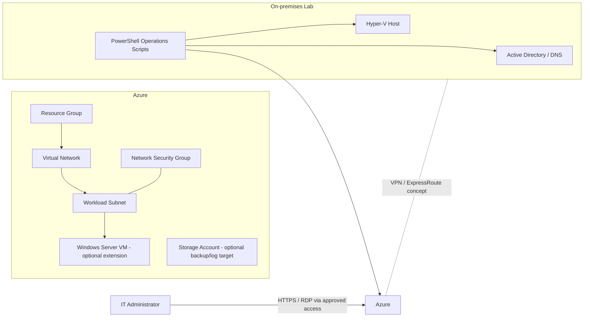

# Hybrid Cloud Infrastructure Management & Automation

**Portfolio lab | Azure + Windows Server + PowerShell + Terraform**

This repository is a hands-on portfolio lab demonstrating infrastructure engineering practices relevant to hybrid IT operations. It is designed around common enterprise responsibilities: Windows Server administration, Azure networking, repeatable infrastructure provisioning, health checks, and operational documentation.

> **Transparency:** This is a demonstration project/template, not evidence of a production deployment. Run it in a test subscription and lab environment. Replace example values and document your own test results before presenting it as completed work.

## Architecture



The VPN/ExpressRoute connection is shown as an architectural integration point only; it is not provisioned by the Terraform example.

## Repository layout

- `terraform/` — minimal Azure resource group, VNet, subnet and NSG baseline.
- `powershell/` — read-only Windows server health and inventory scripts.
- `docs/` — architecture, implementation steps, validation checklist and operations runbook.
- `examples/` — sample configuration values (no secrets).

## Technology

Microsoft Azure, Terraform, PowerShell, Windows Server, Hyper-V concepts, Active Directory/DNS operations, Azure networking, infrastructure documentation.

## Quick start

### 1. Prerequisites
- Azure subscription with permission to create resource groups and networking resources.
- Terraform CLI (1.5+).
- Azure CLI, authenticated with `az login`.
- Windows PowerShell 5.1 or PowerShell 7 for the scripts.
- A Windows Server lab VM/domain only if testing the optional Windows scripts.

### 2. Deploy the Azure network baseline

```powershell
cd terraform
terraform init
terraform fmt -check
terraform validate
terraform plan -out tfplan
# Review the plan carefully before applying:
terraform apply tfplan
```

Set the subscription with `az account set --subscription "<subscription-id>"` before planning. The example intentionally does not create a public IP, VM, VPN gateway, or open inbound management ports.

### 3. Run the PowerShell health report

Open an elevated PowerShell session on a Windows test server:

```powershell
Set-ExecutionPolicy -Scope Process -ExecutionPolicy RemoteSigned
.\powershell\Get-ServerHealth.ps1 -OutputPath .\health-report.txt
```

The script is read-only. It reports OS, uptime, CPU/memory snapshot, disk free space and selected service states.

### 4. Clean up

After reviewing resources, run `terraform destroy` from the `terraform/` directory. Confirm the plan before approving deletion.

## Security design decisions

- No credentials, tokens, connection strings or private keys are stored in this repository.
- No inbound RDP/SSH rule is created.
- NSG starts with no custom inbound allow rules.
- Use Azure RBAC least privilege and managed identity where applicable.
- Store secrets in Azure Key Vault for future extensions.
- Use private connectivity (VPN/ExpressRoute) and approved jump-host/Bastion patterns for administration.
- Review costs and resource locations before deployment.

## Validation checklist

- [ ] `terraform fmt -check` passes.
- [ ] `terraform validate` passes.
- [ ] `terraform plan` reviewed and approved.
- [ ] Resource group, VNet, subnet and NSG visible in Azure Portal.
- [ ] PowerShell report generated on a Windows test server.
- [ ] Screenshots captured with subscription IDs, public IPs and personal data hidden.
- [ ] Cleanup completed or resources intentionally retained with budget alerts.

## Suggested evidence to add

Add your own screenshots to `docs/screenshots/` after performing the lab:
1. Terraform plan (hide tenant/subscription identifiers).
2. Azure resource group and VNet overview.
3. PowerShell health report with hostnames anonymized.
4. A short test-results table describing what you verified.

## Portfolio description

Built a hybrid infrastructure operations lab combining Azure network provisioning with PowerShell-based Windows Server health reporting. The project demonstrates infrastructure-as-code fundamentals, secure-by-default networking, operational automation, validation, and lifecycle cleanup.

**Do not claim production deployment, uptime improvement, or business impact unless you have measured and verified it yourself.**
